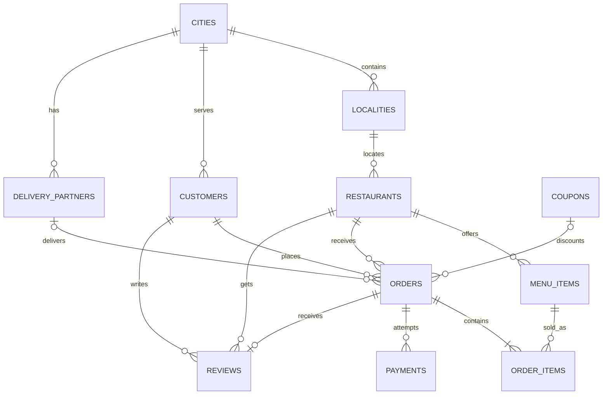

# Schema design

## Design summary

The schema is in the `zomato` PostgreSQL schema. It mirrors the 11 CSV files
and uses `timestamptz` for the supplied offsets, `numeric` for money, boolean
columns for `t/f`, `text[]` for restaurant cuisines, and SQL `NULL` for empty
CSV fields. No non-constraint indexes are created in Phase 2; PostgreSQL
creates indexes only for primary-key and unique constraints.

## Data dictionary

### Reference and user tables

| Table | Columns (type; key/constraint) | Reason |
|---|---|---|
| `cities` | `city_id` integer PK; `city_name` text NOT NULL UNIQUE; `state` text NOT NULL | Stable city key; city names are natural unique labels. |
| `localities` | `locality_id` integer PK; `city_id` integer NOT NULL FK to `cities`; `locality_name` text NOT NULL; `pincode` text NOT NULL UNIQUE; UNIQUE(`city_id`,`locality_name`) | Pincodes are kept as text so formatting is preserved; locality names are unique within a city. |
| `customers` | `customer_id` integer PK; `full_name` text; `email` text UNIQUE; `phone` text UNIQUE; `city_id` FK; `signup_date` date; `is_gold_member` boolean; nullable `gold_expires_on` date; `is_active` boolean | Email/phone identify an account; gold expiry is absent for non-Gold customers. |
| `delivery_partners` | `partner_id` integer PK; `full_name` text; `phone` text UNIQUE; `city_id` FK; `vehicle_type` in BIKE/SCOOTER/EV/BICYCLE; `joined_on` date; `rating` numeric(2,1) 1–5; `status` in ACTIVE/INACTIVE/BLOCKED | Partner status and vehicle values are controlled business domains. |

### Catalog and commercial tables

| Table | Columns (type; key/constraint) | Reason |
|---|---|---|
| `restaurants` | `restaurant_id` integer PK; `name` text; `locality_id` FK; `cuisines` text[]; `avg_cost_for_two` numeric(10,2) >= 0; nullable `rating` numeric(2,1) 1–5; `rating_count` integer >= 0; `opens_at`, `closes_at` time with opening before closing; `is_pure_veg` boolean; `status` in OPEN/TEMPORARILY_CLOSED/DELISTED; `onboarded_on` date | Cuisines are an array because the export stores multiple values in one restaurant attribute. Rating is nullable for restaurants with no rating yet. |
| `menu_items` | `item_id` integer PK; `restaurant_id` FK; `item_name` text; `category` in Main Course/Starters/Rice/Breads/Desserts/Beverages; `price` numeric(10,2) > 0; `is_veg`, `is_bestseller`, `is_available` boolean | Each item belongs to exactly one restaurant; positive prices are required. |
| `coupons` | `coupon_code` text PK; `discount_pct` numeric(5,2) 0–100; `max_discount`, `min_order_value` numeric(10,2) >= 0; `valid_from`, `valid_to` date with valid_to >= valid_from | Coupon code is the natural key; the date and percentage checks prevent invalid offers. |

### Order and feedback tables

| Table | Columns (type; key/constraint) | Reason |
|---|---|---|
| `orders` | `order_id` integer PK; customer/restaurant FKs; nullable partner and coupon FKs; four nullable lifecycle `timestamptz` values; `distance_km` numeric(6,2) >= 0; item/delivery/discount/total numeric(12,2); status in seven supplied values | Partner/coupon are optional. Timeline checks enforce non-decreasing event times, required events for active/delivered states, and the total formula. |
| `order_items` | composite PK (`order_id`,`item_id`); both FKs; `quantity` smallint > 0; `unit_price` numeric(10,2) > 0 | This resolves the order-to-menu-item many-to-many relationship and stores the historical sale price. |
| `payments` | `payment_id` integer PK; `order_id` FK; `amount` numeric(12,2) > 0; method in UPI/CARD/WALLET/COD; status in SUCCESS/FAILED/REFUNDED; `attempted_at` timestamptz | Multiple attempts per order are valid, so `order_id` is not unique. |
| `reviews` | `review_id` integer PK; `order_id` UNIQUE FK; customer/restaurant FKs; food rating 1–5; nullable delivery rating 1–5; nullable text; created timestamp | At most one review is present per order in the export. Nullable delivery rating/text matches the data. |

The schema has more than 12 meaningful constraints: primary and foreign
keys, unique candidate keys, controlled status/method/category domains,
positive/range checks, date ordering, order-event sequencing, conditional
event requirements, and the order amount identity. Foreign keys to ownership
data use `RESTRICT` to avoid silently deleting history. Order children cascade
when an order is removed; optional assignment/coupon references use `SET
NULL`.

## Relationships and ER diagram

- City 1:N locality, customer, and delivery partner.
- Locality 1:N restaurant; restaurant 1:N menu item and order.
- Customer 1:N order; delivery partner 1:N order; coupon 1:N order.
- Order 1:N order item and payment, and 1:0..1 review.
- Menu item 1:N order item, making orders and menu items M:N through
  `order_items`.

The rendered diagram is [`diagrams/er_diagram.png`](../diagrams/er_diagram.png).

## Functional dependencies and normal form

All tables use a surrogate or natural key whose non-key attributes describe
that row. The main dependencies are:

- `cities`: `city_id -> city_name, state`; `city_name -> city_id, state`.
- `localities`: `locality_id -> city_id, locality_name, pincode`;
  `(city_id, locality_name) -> locality_id, pincode`.
- `customers`: `customer_id -> all other customer columns`;
  `email -> customer_id`; `phone -> customer_id`.
- `restaurants`: `restaurant_id -> all other restaurant columns`.
- `menu_items`: `item_id -> all other menu-item columns`.
- `delivery_partners`: `partner_id -> all other partner columns`;
  `phone -> partner_id`.
- `coupons`: `coupon_code -> all coupon attributes`.
- `orders`: `order_id -> all order attributes`.
- `order_items`: `(order_id, item_id) -> quantity, unit_price`.
- `payments`: `payment_id -> order_id, amount, method, payment_status,
  attempted_at`.
- `reviews`: `review_id -> all review attributes`; `order_id -> review_id,
  customer_id, restaurant_id, ratings, text, created_at` due to the unique
  order review.

The relational core is in 1NF: scalar columns are atomic and `order_items`
removes the repeating group from orders. `restaurants.cuisines` is the one
intentional PostgreSQL array exception, retained because it matches the
export and the supplied `ANY` query; a strict 1NF redesign would split it
into a `restaurant_cuisines(restaurant_id, cuisine)` bridge table. For the
stored scalar attributes, every non-key attribute depends on the whole key,
so the relations are in 2NF. There are no non-key determinants among those
attributes, so they are in 3NF and, given the listed candidate keys, BCNF.

Three values are intentionally retained despite being derived or duplicated:
`orders.total_amount` is the historical charged amount and is protected by a
check; restaurant rating/count are a read-optimized snapshot maintained by
the nightly workload; and `is_pure_veg` is a restaurant declaration, not a
claim inferred from current menu rows. `reviews.customer_id` and
`reviews.restaurant_id` duplicate order ownership for direct moderation
queries. The load checks confirm these copies agree with their order.

## Load verification and data findings

Run `psql <database> -f sql/01_schema.sql` followed by
`psql <database> -f sql/02_load_data.sql` from this project directory. The
load script prints the expected counts: 10, 100, 25,000, 2,500, 50,000,
2,000, 30, 150,000, 375,000, 137,378, and 39,186 respectively.

The three zero-result integrity checks are:

1. every order line's menu item belongs to its order's restaurant;
2. review customer and restaurant agree with the referenced order; and
3. every order total equals item total plus delivery fee minus discount.

The additional payment check returns **1,304**, not zero: those delivered
orders have no `SUCCESS` payment attempt (they are not rejected by the
schema because the source export contains them). Other notable valid nulls
are 124 restaurant ratings, 21,208 non-Gold expiry dates, optional order
lifecycle timestamps for cancelled/early orders, and 7,741 review delivery
ratings. No invalid foreign keys or duplicate primary keys were found.
